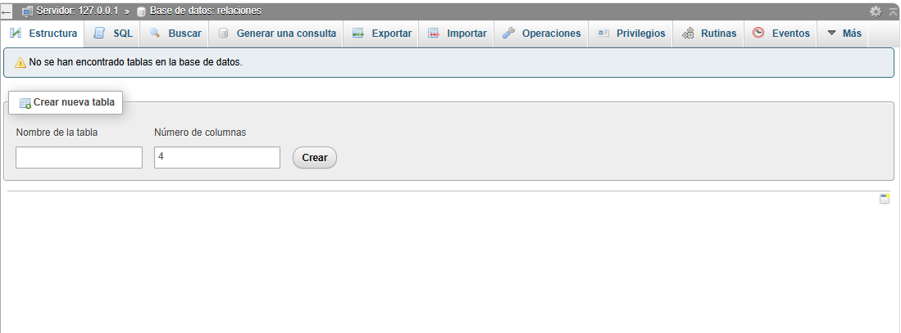
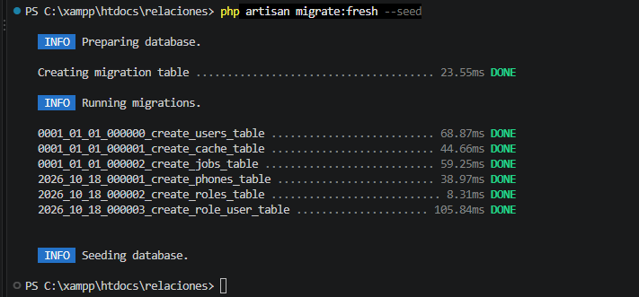
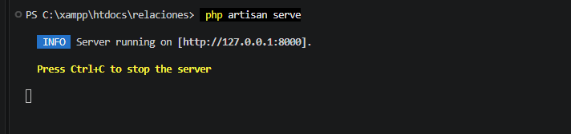
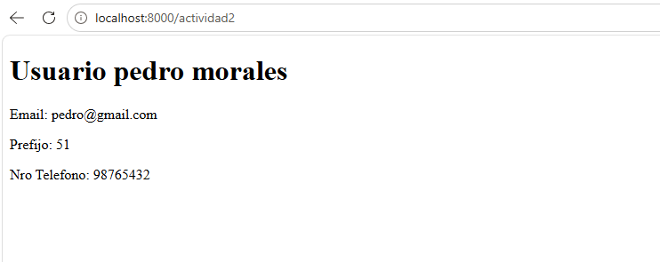
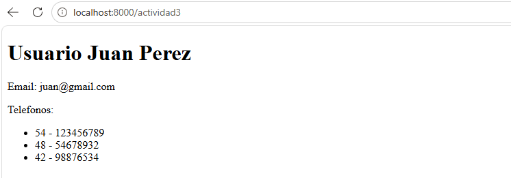
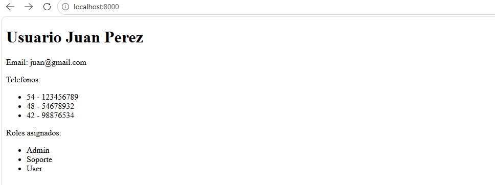
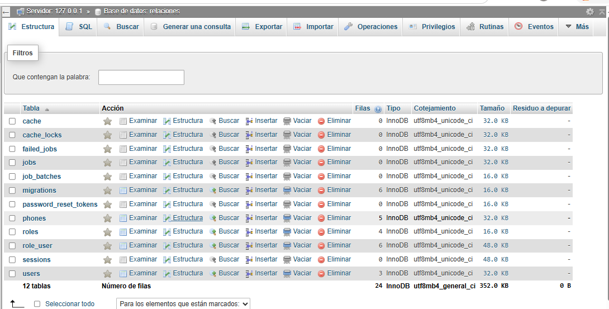

# INSTITUTO DE EDUCACIÓN SUPERIOR TECNOLÓGICO PÚBLICO
## "PEDRO P. DÍAZ"

### LABORATORIO N.° 09
#### Trabajando Relaciones en Laravel (Eloquent ORM): Uno a Uno, Uno a Muchos y Muchos a Muchos

| | |
|---|---|
| **Carrera profesional** | Desarrollo de Sistemas de Información |
| **Módulo formativo** | Programación de Sistemas de Información |
| **Unidad didáctica** | DESARROLLO WEB INTEGRADO |
| **Estudiante** | Juan José Condori Bolívar |
| **Semestre** | IV |
| **Fecha** | 18 de octubre de 2026 |
| **Año académico** | 2026 |

---

## 1. Objetivos

- Construir aplicaciones con tablas relacionadas en Laravel utilizando el ORM Eloquent.
- Definir y probar los tres tipos de relación estudiados en clase: **uno a uno**, **uno a muchos** y **muchos a muchos**.
- Comprender la convención de Laravel para las claves foráneas y la tabla pivote, y cuándo es necesario sobrescribirla.
- Mostrar en una vista Blade la información de varias tablas relacionadas sin escribir consultas `JOIN` en SQL.

---

## 2. Temas tratados

Relaciones en Laravel con el ORM Eloquent: mapeo objeto-relacional, relaciones `hasOne`, `hasMany`, `belongsTo` y `belongsToMany`, claves foráneas, tabla pivote, propiedades dinámicas de relación y uso de las relaciones en vistas Blade.

---

## 3. Marco teórico: relaciones en Eloquent

**Eloquent** es la librería de Laravel que implementa el patrón **ORM** (*Object-Relational Mapping*): convierte los registros de las tablas en objetos de la aplicación, de modo que no es necesario escribir ni depurar SQL. Las relaciones entre tablas también se manejan con Eloquent: se definen **como métodos en las clases modelo** y, una vez definidas, pueden consultarse como si fueran atributos del objeto (*propiedades dinámicas de relación*).

Una regla clave de la guía: **el modelo que contiene la clave foránea "pertenece a" el modelo que no la contiene**. Por ejemplo, la tabla `phones` tiene la columna `user_id`; por lo tanto, el teléfono *pertenece a* un usuario y el usuario *tiene* un teléfono.

| Tipo de relación | Método en el modelo padre | Método en el modelo hijo | Dónde está la clave foránea |
|---|---|---|---|
| Uno a uno | `hasOne` | `belongsTo` | Tabla del modelo hijo (`phones.user_id`) |
| Uno a muchos | `hasMany` | `belongsTo` | Tabla del modelo hijo (`phones.user_id`) |
| Muchos a muchos | `belongsToMany` | `belongsToMany` | Tabla pivote (`role_user.role_id` y `role_user.user_id`) |

**Convenciones de Laravel** que se respetaron en este laboratorio:

- La clave foránea se nombra con el singular de la tabla padre más `_id` (`user_id`, `role_id`).
- La tabla pivote se nombra con los dos modelos en **orden alfabético** separados por guion bajo (`role_user`).
- Si no se respetan estas convenciones, los nombres se indican como argumentos adicionales del método (por ejemplo, `hasOne(Phone::class, 'foreign_key', 'local_key')` o `belongsToMany(Role::class, 'tabla', 'fk_modelo', 'fk_relacionado')`).

Además, cada relación existe de dos formas: como **propiedad** (`$user->phones`), que devuelve directamente los registros relacionados, y como **método** (`$user->phones()`), que devuelve un constructor de consultas al que se pueden encadenar condiciones, por ejemplo `$user->phones()->where('prefijo', 54)->first()`.

---

## 4. Decisiones técnicas del laboratorio

**Una sola base de datos para las cuatro actividades.** Se trabajó con la base de datos `relaciones` y las tablas `users`, `phones`, `roles` y `role_user`. Las migraciones de las cuatro actividades se ejecutaron en una sola corrida con `php artisan migrate:fresh --seed`.

**Datos de prueba con un *seeder*.** En lugar de ingresar los registros uno a uno desde phpMyAdmin, como plantea la guía, se cargaron con `DatabaseSeeder`. Los datos son los mismos de la guía: 3 usuarios, 5 teléfonos, 4 roles y 6 asignaciones en la tabla pivote. Así el laboratorio se puede reproducir con un solo comando.

**Claves foráneas con integridad referencial.** A lo planteado en la guía se agregó la restricción `foreign()` con `onDelete('cascade')` en las migraciones de `phones` y `role_user`, de modo que la base de datos impida teléfonos o roles asignados a usuarios inexistentes.

**Los métodos `phone()` y `phones()` conviven en `User`.** La Actividad 3 de la guía modifica `phone()` y lo convierte en `phones()` (de `hasOne` a `hasMany`). Para poder probar las tres actividades por separado, el modelo conserva ambos métodos.

**Una ruta y una vista por actividad.** `/actividad2`, `/actividad3` y `/` (Actividad 4, vista final con teléfonos y roles), con el mismo `UserController`.

---

## 5. Estructura final del proyecto

```
relaciones/
├── app/
│   ├── Http/
│   │   └── Controllers/
│   │       └── UserController.php
│   └── Models/
│       ├── Phone.php
│       ├── Role.php
│       └── User.php
├── database/
│   ├── migrations/
│   │   ├── 0001_01_01_000000_create_users_table.php        (por defecto de Laravel)
│   │   ├── 0001_01_01_000001_create_cache_table.php        (por defecto de Laravel)
│   │   ├── 0001_01_01_000002_create_jobs_table.php         (por defecto de Laravel)
│   │   ├── 2026_10_18_000001_create_phones_table.php
│   │   ├── 2026_10_18_000002_create_roles_table.php
│   │   └── 2026_10_18_000003_create_role_user_table.php
│   └── seeders/
│       └── DatabaseSeeder.php
├── resources/
│   └── views/
│       ├── actividad2.blade.php
│       ├── actividad3.blade.php
│       └── index.blade.php
├── routes/
│   └── web.php
├── .env                         (conexión a la base de datos relaciones)
├── capturas/                    (capturas de este informe)
└── ...
```

---

## 6. Proceso de desarrollo

### Actividad 1. Preparando los modelos y las migraciones

#### 6.1 Creación del proyecto

Desde la terminal de Visual Studio Code, dentro de `C:\xampp\htdocs`, se creó el proyecto Laravel (versión 12.70.0 con PHP 8.2.12):

```bash
composer create-project laravel/laravel relaciones
```

#### 6.2 Base de datos y archivo `.env`

Con Apache y MySQL encendidos desde el panel de XAMPP, se creó en phpMyAdmin la base de datos **`relaciones`**. En este punto la base de datos está vacía:



Se configuró el acceso en el archivo `.env`:

```env
DB_CONNECTION=mysql
DB_HOST=127.0.0.1
DB_PORT=3306
DB_DATABASE=relaciones
DB_USERNAME=root
DB_PASSWORD=
```

#### 6.3 Modelo y migración de `Phone`

La tabla `users` ya existe en Laravel; se creó el modelo y la migración de la tabla `phones` con un solo comando (el parámetro `--migration` genera la migración correspondiente):

```bash
php artisan make:model Phone --migration
```

En la migración se definieron las columnas `prefijo` y `numero` y, para vincular con la tabla `users`, la clave foránea `user_id`, nombrada según la convención de Laravel (`user` por la tabla y `id` por su llave primaria):

```php
<?php

use Illuminate\Database\Migrations\Migration;
use Illuminate\Database\Schema\Blueprint;
use Illuminate\Support\Facades\Schema;

return new class extends Migration
{
    // ACTIVIDAD 1: tabla phones con la clave foránea user_id (convención Laravel)
    public function up(): void
    {
        Schema::create('phones', function (Blueprint $table) {
            $table->id();
            $table->unsignedInteger('prefijo');
            $table->unsignedBigInteger('numero');
            $table->unsignedBigInteger('user_id');
            $table->timestamps();

            $table->foreign('user_id')->references('id')->on('users')->onDelete('cascade');
        });
    }

    public function down(): void
    {
        Schema::dropIfExists('phones');
    }
};
```

---

### Actividad 2. Creando la relación Uno a Uno

Como el modelo que contiene la clave foránea es `Phone`, el usuario **tiene un** teléfono (`hasOne`) y el teléfono **pertenece a** un usuario (`belongsTo`).

En `app/Models/User.php` se agregó el método `phone()` de tipo `hasOne` (con sus `use` correspondientes al inicio del archivo):

```php
use Illuminate\Database\Eloquent\Relations\HasOne;

// ACTIVIDAD 2 - Relación Uno a Uno:
// el usuario NO tiene la clave foránea, el teléfono sí (phones.user_id) => hasOne
public function phone(): HasOne
{
    return $this->hasOne(Phone::class);
    // Si no se siguen las convenciones de Laravel:
    // return $this->hasOne(Phone::class, 'user_id', 'id');
}
```

En `app/Models/Phone.php` se agregó la relación inversa `user()` de tipo `belongsTo`:

```php
<?php

namespace App\Models;

use Illuminate\Database\Eloquent\Factories\HasFactory;
use Illuminate\Database\Eloquent\Model;
use Illuminate\Database\Eloquent\Relations\BelongsTo;

class Phone extends Model
{
    use HasFactory;

    protected $guarded = [];

    // Relación inversa: el teléfono contiene la clave foránea (user_id),
    // por lo tanto "pertenece a" un usuario => belongsTo
    public function user(): BelongsTo
    {
        return $this->belongsTo(User::class);
        // Si no se siguen las convenciones:
        // return $this->belongsTo(User::class, 'user_id', 'id');
    }
}
```

#### Usando la relación en una vista

Se creó el controlador `UserController` con un método por actividad. El de la Actividad 2 busca el usuario con `id` 2 y lo envía a la vista:

```bash
php artisan make:controller UserController
```

```php
<?php

namespace App\Http\Controllers;

use App\Models\User;

class UserController extends Controller
{
    // ACTIVIDAD 2: relación 1:1 (usuario -> teléfono). Usuario con id 2
    public function actividad2()
    {
        $user = User::findOrFail(2);
        return view('actividad2', compact('user'));
    }

    // ACTIVIDAD 3: relación 1:N (usuario -> varios teléfonos). Usuario con id 1
    public function actividad3()
    {
        $user = User::findOrFail(1);
        return view('actividad3', compact('user'));
    }

    // ACTIVIDAD 4: relación N:N (usuario -> roles) + teléfonos. Usuario con id 1
    public function index()
    {
        $user = User::findOrFail(1);
        return view('index', compact('user'));
    }
}
```

Las rutas se definieron en `routes/web.php`, enlazando el controlador con `use App\Http\Controllers\UserController;`:

```php
<?php

use App\Http\Controllers\UserController;
use Illuminate\Support\Facades\Route;

// Actividad 4 (vista final: teléfonos + roles)
Route::get('/', [UserController::class, 'index'])->name('index');

// Actividad 2: Uno a Uno
Route::get('/actividad2', [UserController::class, 'actividad2'])->name('actividad2');

// Actividad 3: Uno a Muchos
Route::get('/actividad3', [UserController::class, 'actividad3'])->name('actividad3');
```

Y la vista `resources/views/actividad2.blade.php` accede a los datos del teléfono llamando a `phone` desde el modelo `User`:

```html
<!DOCTYPE html>
<html lang="es">
<head>
    <meta charset="UTF-8">
    <meta name="viewport" content="width=device-width, initial-scale=1.0">
    <title>Actividad 2 - Uno a Uno</title>
</head>
<body>
    {{-- Relación 1:1: $user->phone devuelve UN solo teléfono --}}
    <h1>Usuario {{ $user->name }}</h1>
    <p>Email: {{ $user->email }}</p>
    <p>Prefijo: {{ $user->phone->prefijo }}</p>
    <p>Nro Telefono: {{ $user->phone->numero }}</p>
</body>
</html>
```

---

### Actividad 3. Relación Uno a Muchos

La estructura de las tablas permanece igual: ahora un usuario puede tener varios teléfonos, pero un teléfono pertenece a un solo usuario. El modelo `Phone` no cambia; en `User` se agregó el método `phones()` de tipo `hasMany`:

```php
use Illuminate\Database\Eloquent\Relations\HasMany;

// ACTIVIDAD 3 - Relación Uno a Muchos:
// un usuario puede tener varios teléfonos => hasMany
public function phones(): HasMany
{
    return $this->hasMany(Phone::class);
}
```

La vista `resources/views/actividad3.blade.php` recorre la colección de teléfonos con la directiva `@foreach`:

```html
<body>
    {{-- Relación 1:N: $user->phones devuelve una colección de teléfonos --}}
    <h1>Usuario {{ $user->name }}</h1>
    <p>Email: {{ $user->email }}</p>
    <p>Telefonos: </p>
    <ul>
        @foreach ($user->phones as $phone)
            <li>
                {{ $phone->prefijo }} - {{ $phone->numero }}
            </li>
        @endforeach
    </ul>
</body>
```

---

### Actividad 4. Relación Muchos a Muchos

Un usuario puede tener varios roles dentro del sistema y un rol puede ser desempeñado por varios usuarios. No se puede colocar un `role_id` en `users` ni un `user_id` en `roles`, por lo que se necesita una **tabla de paso** (pivote) llamada `role_user` (nombres de los modelos en orden alfabético separados por guion bajo).

#### 6.4 Modelo y migración de `Role`

```bash
php artisan make:model Role --migration
```

La migración de `roles` solo utiliza una columna (`nombre`) para describir el rol:

```php
public function up(): void
{
    Schema::create('roles', function (Blueprint $table) {
        $table->id();
        $table->string('nombre');
        $table->timestamps();
    });
}
```

#### 6.5 Migración de la tabla pivote `role_user`

```bash
php artisan make:migration create_role_user_table
```

Con las dos columnas que relacionan `roles` y `users`, nombradas según la convención de Laravel (`role_id` y `user_id`):

```php
public function up(): void
{
    Schema::create('role_user', function (Blueprint $table) {
        $table->id();
        $table->unsignedBigInteger('role_id');
        $table->unsignedBigInteger('user_id');
        $table->timestamps();

        $table->foreign('role_id')->references('id')->on('roles')->onDelete('cascade');
        $table->foreign('user_id')->references('id')->on('users')->onDelete('cascade');
    });
}
```

#### 6.6 Relaciones en los modelos

Ambos lados de la relación usan `belongsToMany`. En `User.php`:

```php
use Illuminate\Database\Eloquent\Relations\BelongsToMany;

// ACTIVIDAD 4 - Relación Muchos a Muchos:
// un usuario tiene varios roles a través de la tabla pivote role_user => belongsToMany
public function roles(): BelongsToMany
{
    return $this->belongsToMany(Role::class);
    // Si no se siguen las convenciones:
    // return $this->belongsToMany(Role::class, 'role_user', 'user_id', 'role_id');
}
```

Y en `Role.php`:

```php
<?php

namespace App\Models;

use Illuminate\Database\Eloquent\Factories\HasFactory;
use Illuminate\Database\Eloquent\Model;
use Illuminate\Database\Eloquent\Relations\BelongsToMany;

class Role extends Model
{
    use HasFactory;

    protected $guarded = [];

    // ACTIVIDAD 4 - Un rol puede ser desempeñado por varios usuarios => belongsToMany
    public function users(): BelongsToMany
    {
        return $this->belongsToMany(User::class);
        // Si no se siguen las convenciones de nombres de tabla/columnas:
        // return $this->belongsToMany(User::class, 'role_user', 'role_id', 'user_id');
    }
}
```

#### 6.7 Vista con los roles asignados

La vista final `resources/views/index.blade.php` muestra los datos del usuario, sus teléfonos y los roles asignados:

```html
<body>
    <h1>Usuario {{ $user->name }}</h1>
    <p>Email: {{ $user->email }}</p>

    {{-- Relación 1:N --}}
    <p>Telefonos: </p>
    <ul>
        @foreach ($user->phones as $phone)
            <li>
                {{ $phone->prefijo }} - {{ $phone->numero }}
            </li>
        @endforeach
    </ul>

    {{-- Relación N:N (tabla pivote role_user) --}}
    <p>Roles asignados: </p>
    <ul>
        @foreach ($user->roles as $role)
            <li>
                {{ $role->nombre }}
            </li>
        @endforeach
    </ul>
</body>
```

---

### 6.8 Migraciones y datos de prueba

Los registros de prueba se cargan con el *seeder* `database/seeders/DatabaseSeeder.php`, que inserta los mismos datos de la guía:

```php
<?php

namespace Database\Seeders;

use Illuminate\Database\Seeder;
use Illuminate\Support\Facades\DB;
use Illuminate\Support\Facades\Hash;

class DatabaseSeeder extends Seeder
{
    public function run(): void
    {
        $now = now();

        // 3 usuarios
        DB::table('users')->insert([
            ['id' => 1, 'name' => 'Juan Perez',    'email' => 'juan@gmail.com',  'password' => Hash::make('password'), 'created_at' => $now, 'updated_at' => $now],
            ['id' => 2, 'name' => 'pedro morales', 'email' => 'pedro@gmail.com', 'password' => Hash::make('password'), 'created_at' => $now, 'updated_at' => $now],
            ['id' => 3, 'name' => 'Ana Pinto',     'email' => 'ana@gmail.com',   'password' => Hash::make('password'), 'created_at' => $now, 'updated_at' => $now],
        ]);

        // 5 teléfonos (el usuario 1 tiene 3 -> Actividad 3)
        DB::table('phones')->insert([
            ['id' => 1, 'prefijo' => 54, 'numero' => 123456789, 'user_id' => 1, 'created_at' => $now, 'updated_at' => $now],
            ['id' => 2, 'prefijo' => 51, 'numero' => 98765432,  'user_id' => 2, 'created_at' => $now, 'updated_at' => $now],
            ['id' => 3, 'prefijo' => 45, 'numero' => 24689451,  'user_id' => 3, 'created_at' => $now, 'updated_at' => $now],
            ['id' => 4, 'prefijo' => 48, 'numero' => 54678932,  'user_id' => 1, 'created_at' => $now, 'updated_at' => $now],
            ['id' => 5, 'prefijo' => 42, 'numero' => 98876534,  'user_id' => 1, 'created_at' => $now, 'updated_at' => $now],
        ]);

        // 4 roles
        DB::table('roles')->insert([
            ['id' => 1, 'nombre' => 'Admin',    'created_at' => $now, 'updated_at' => $now],
            ['id' => 2, 'nombre' => 'Soporte',  'created_at' => $now, 'updated_at' => $now],
            ['id' => 3, 'nombre' => 'User',     'created_at' => $now, 'updated_at' => $now],
            ['id' => 4, 'nombre' => 'Invitado', 'created_at' => $now, 'updated_at' => $now],
        ]);

        // Tabla pivote role_user (usuario 1: Admin, Soporte, User)
        DB::table('role_user')->insert([
            ['id' => 1, 'role_id' => 1, 'user_id' => 1, 'created_at' => $now, 'updated_at' => $now],
            ['id' => 2, 'role_id' => 2, 'user_id' => 1, 'created_at' => $now, 'updated_at' => $now],
            ['id' => 3, 'role_id' => 1, 'user_id' => 2, 'created_at' => $now, 'updated_at' => $now],
            ['id' => 4, 'role_id' => 3, 'user_id' => 2, 'created_at' => $now, 'updated_at' => $now],
            ['id' => 5, 'role_id' => 3, 'user_id' => 1, 'created_at' => $now, 'updated_at' => $now],
            ['id' => 6, 'role_id' => 4, 'user_id' => 2, 'created_at' => $now, 'updated_at' => $now],
        ]);
    }
}
```

Se ejecutaron las migraciones junto con el *seeder*. Las seis migraciones (las tres por defecto de Laravel y las tres de este laboratorio) terminaron en `DONE` y se cargaron los datos (`Seeding database`):

```bash
php artisan migrate:fresh --seed
```



### 6.9 Servidor de desarrollo

Se levantó el servidor de pruebas, que atiende en `http://127.0.0.1:8000`:

```bash
php artisan serve
```



---

## 7. Funcionamiento de la aplicación

| N.° | Actividad | URL | Resultado esperado | Resultado obtenido |
|---|---|---|---|---|
| 1 | Uno a Uno | `/actividad2` | Usuario *pedro morales* con su único teléfono (51 - 98765432) | ✓ |
| 2 | Uno a Muchos | `/actividad3` | Usuario *Juan Perez* con sus 3 teléfonos | ✓ |
| 3 | Muchos a Muchos | `/` | Usuario *Juan Perez* con sus teléfonos y los roles Admin, Soporte y User | ✓ |

### 7.1 Relación Uno a Uno

La vista `/actividad2` muestra el nombre y el email del usuario con `id` 2, además del prefijo y el número de su teléfono, obtenidos a través de `$user->phone`:



### 7.2 Relación Uno a Muchos

La vista `/actividad3` recorre con `@foreach` los tres teléfonos del usuario con `id` 1 (54 - 123456789, 48 - 54678932 y 42 - 98876534):



### 7.3 Relación Muchos a Muchos

La vista `/` muestra, además de los teléfonos, los roles asignados al usuario con `id` 1 a través de la tabla pivote `role_user`: Admin, Soporte y User:



### 7.4 Verificación en la base de datos (phpMyAdmin)

La base de datos `relaciones` quedó con 12 tablas. Las propias del laboratorio son `users` (3 filas), `phones` (5 filas), `roles` (4 filas) y `role_user` (6 filas); las demás (`cache`, `cache_locks`, `failed_jobs`, `jobs`, `job_batches`, `migrations`, `password_reset_tokens` y `sessions`) las genera Laravel por defecto:



---

## 8. Conclusiones

- Eloquent permite acceder a los datos de tablas relacionadas como si fueran atributos del modelo (`$user->phone`, `$user->phones`, `$user->roles`), sin escribir consultas `JOIN` en SQL.
- Para definir correctamente una relación hay que identificar qué tabla contiene la clave foránea: el modelo que la contiene usa `belongsTo` y el modelo que no la contiene usa `hasOne` o `hasMany`.
- La diferencia entre las relaciones uno a uno y uno a muchos está únicamente en el método del modelo padre (`hasOne` frente a `hasMany`); la estructura de las tablas no cambia.
- Las relaciones muchos a muchos requieren una tabla pivote, ya que ninguna de las dos tablas puede guardar por sí sola la clave de la otra; su nombre sigue la convención de los dos modelos en orden alfabético (`role_user`).
- Respetar las convenciones de nombres (`user_id`, `role_id`, `role_user`) evita tener que indicar manualmente las claves y la tabla en cada relación.
- Cada relación puede usarse como propiedad (`$user->phones`) para obtener los registros, o como método (`$user->phones()`) para encadenar condiciones de consulta adicionales.
- Cargar los datos de prueba con un *seeder* hace que el laboratorio sea reproducible con un solo comando (`php artisan migrate:fresh --seed`).

---

## 9. Repositorio

Código fuente completo disponible en este repositorio de GitHub.
